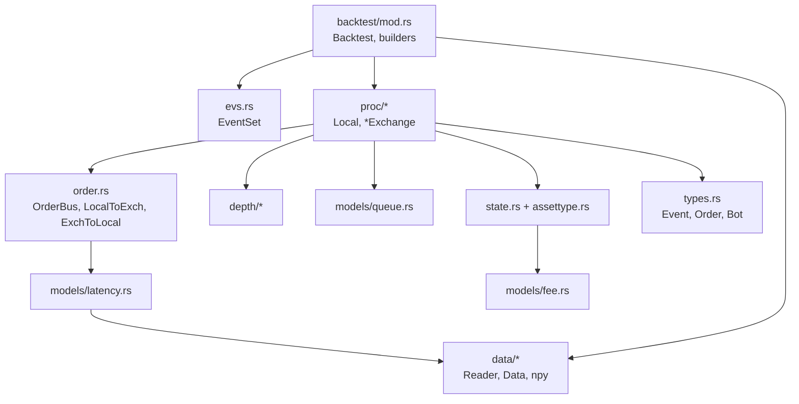
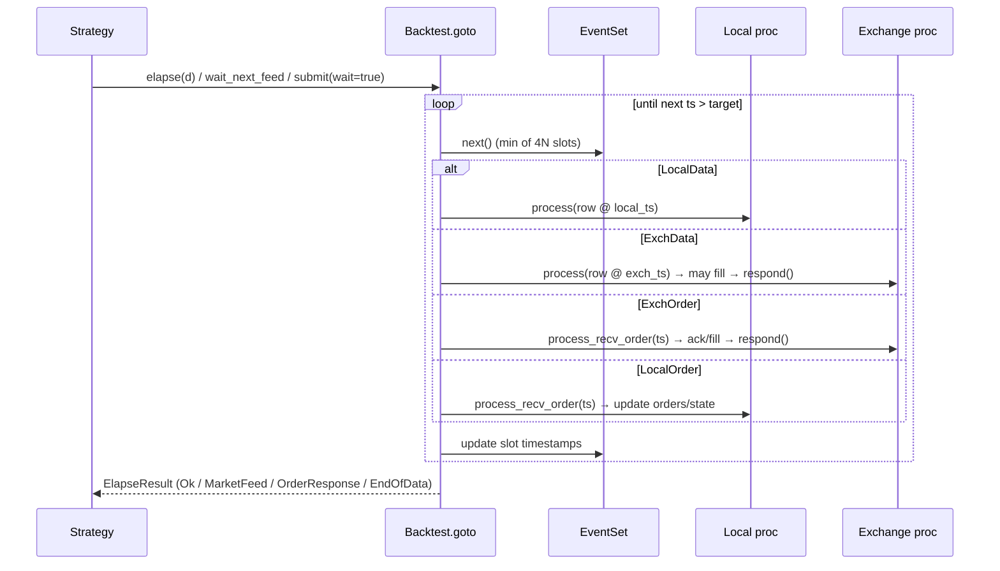

# 01 — hftbacktest Architecture Analysis (Part 1 of 2)

> Part 1: §0 Sources, §1 Repository map, §2 Data model, §3 Simulation core, §4 Two-sided model, §5 Orderbooks, §6 Matching and fills.
> Part 2 ([01-architecture-analysis-part2.md](01-architecture-analysis-part2.md)): §7 Queue models, §8 Latency and fee models, §9 Asset types and state, §10 Multi-asset, recording, live, §11 Performance and limitations, §12 Copy / change / avoid table.

---

## 0. Sources and confidence

| Item | Value |
|---|---|
| Repository | https://github.com/nkaz001/hftbacktest.git |
| Commit analyzed | `5f3ec40b2afb764e0fea112f941ed85523ef4e88` (2025-12-23, "fix: update the order status to `Status::New` when the order is modified") |
| License | MIT, © 2022 nkaz001 (`LICENSE`). Copying is allowed if the notice is kept. We will **not** copy code. |
| Local clone | `ref/hftbacktest/` (made read-only with `chmod -R a-w`) |
| Rust toolchain stated | rustc 1.90 badge (`README.rst:269`) |

**Attribution.** This study describes the design of hftbacktest by nkaz001 in our own words. Any idea later reused in our C++ backtester (two-sided local/exchange processors, the EXCH/LOCAL flagged event stream, order-bus latency queues, probabilistic queue models) will be credited to hftbacktest in our README and design docs.

**Files read in full (core):**
- `hftbacktest/src/types.rs`, `lib.rs`
- `backtest/mod.rs`, `evs.rs`, `order.rs`, `state.rs`, `assettype.rs`, `recorder.rs`
- `backtest/proc/{mod,local,l3_local,nopartialfillexchange,partialfillexchange,l3_nopartialfillexchange}.rs`
- `backtest/models/{mod,queue,latency,fee}.rs`
- `backtest/data/{mod,reader}.rs`, `backtest/data/npy/mod.rs` (read functions)
- `depth/{mod,hashmapmarketdepth}.rs`
- `utils/{mod,aligned}.rs`
- `hftbacktest/examples/{algo,gridtrading_backtest}.rs`
- `py-hftbacktest/hftbacktest/data/validation.py`

**Files read partially:**
- `depth/roivectormarketdepth.rs`, `btreemarketdepth.rs`, `fuse.rs`
- `py-hftbacktest/src/lib.rs` (the `build_asset!` dispatch)
- `hftbacktest/examples/custom_evhandling.rs`
- Cargo manifests

**Surveyed by a delegated read-only sub-agent, with key claims spot-checked by me:**
- `live/*`, `connector/*`, `collector/*`
- the Python converters and stats
- `docs/*.rst`, `ROADMAP.md`
- GitHub issues (#300, #316 and #325 were re-checked against the code and the API)

**Confidence labels used below:**
- Unlabeled statements were read directly in code at the cited location.
- **INFERRED** means reasoned from code but not executed.
- **UNVERIFIED** means not checked: external Binance behavior, runtime performance numbers.

Nothing in this document comes from running the code. Building and running it is Phase 2 work.

---

## 1. Repository map

### 1.1 Workspace layout

`Cargo.toml` is a workspace with 5 members. The release profile uses `lto=true`, `codegen-units=1` and `panic="abort"`.

| Path | Kind | Responsibility |
|---|---|---|
| `hftbacktest/` | Rust lib crate (core) | Event types, the `Bot` trait, backtest engine, depth books, models, live bot client. Features: `backtest`, `live`, `s3` (`hftbacktest/Cargo.toml:23-27`). |
| `hftbacktest/src/types.rs` | module | `Event` record, event flags, `Order`, enums, `Bot` and `Recorder` traits, live IPC message types |
| `hftbacktest/src/backtest/` | module | `Backtest` engine (`mod.rs`), `EventSet` scheduler (`evs.rs`), order bus (`order.rs`), processors (`proc/`), models (`models/`), data I/O (`data/`), `State`, `AssetType`, `BacktestRecorder` |
| `hftbacktest/src/depth/` | module | `MarketDepth`, `L2MarketDepth`, `L3MarketDepth` traits; HashMap, BTree, ROI-vector and Fused implementations |
| `hftbacktest/src/live/` | module | `LiveBot` (same `Bot` trait), iceoryx2 IPC channel, logging recorder |
| `hftbacktest-derive/` | proc-macro crate | `#[derive(NpyDTyped)]` (numpy dtype description) and `build_asset!` (combinatorial monomorphization used by the Python bindings) |
| `py-hftbacktest/` | pyo3 cdylib + Python package | `extern "C"` FFI (`src/backtest.rs`) called from Numba; Python data converters, validation, stats, recorder |
| `connector/` | binary | Separate process holding exchange connections (Binance Futures, Binance Spot, Bybit). Talks to bots over iceoryx2 shared memory. |
| `collector/` | binary | Raw market-data recorder: WS JSON lines with a local ns timestamp, gzip, one file per day |
| `examples/`, `docs/` | notebooks, rst | Tutorials. `docs/order_fill.rst`, `latency_models.rst` and `data.rst` are the most relevant. |

### 1.2 Dependency diagram

```mermaid
graph LR
  derive[hftbacktest-derive<br/>proc-macro]
  core[hftbacktest<br/>core lib]
  py[py-hftbacktest<br/>pyo3 + Numba FFI]
  conn[connector<br/>binary]
  coll[collector<br/>binary]
  ice[(iceoryx2<br/>shared memory)]
  core --> derive
  py --> core
  py --> derive
  conn --> core
  core -. live feature .-> ice
  conn --> ice
  coll -. raw .gz files .-> pyconv[Python converters<br/>data/utils/*.py]
  pyconv -. .npz event files .-> core
```

The collector does not depend on the core crate; its `Cargo.toml` has no `hftbacktest` dependency. The Python data pipeline is the bridge between the two.

### 1.3 Internal module dependency (core crate, backtest path)



---

## 2. Data model

### 2.1 The event record

`types.rs:312-331` defines `Event` as `#[repr(C, align(64))]`. It has 8 fields of 8 bytes each, so a record is exactly **64 bytes, one cache line**:

| Offset | Field | Type | Meaning |
|---|---|---|---|
| 0 | `ev` | u64 | Flag word (see §2.2) |
| 8 | `exch_ts` | i64 | Time the event happened at the exchange (ns by convention) |
| 16 | `local_ts` | i64 | Time the event was received locally |
| 24 | `px` | f64 | Price (as a float, not ticks) |
| 32 | `qty` | f64 | Quantity |
| 40 | `order_id` | u64 | L3 (Market-By-Order) order id only |
| 48 | `ival` | i64 | Reserved / user |
| 56 | `fval` | f64 | Reserved / user |

`unsafe impl POD for Event {}` (`types.rs:333`) marks the record as reinterpretable from raw bytes. `docs/data.rst` documents the same 8-field array-of-structs layout.

### 2.2 Flag word

Bit layout, from `types.rs:150-297`:
- **bits 0–7: event kind**, compared by equality:
  - DEPTH=1, TRADE=2, DEPTH_CLEAR=3, DEPTH_SNAPSHOT=4, DEPTH_BBO=5
  - ADD_ORDER=10, CANCEL_ORDER=11, MODIFY_ORDER=12, FILL=13
- **bit 28 SELL**, **bit 29 BUY**. On a depth event this is the book side; on a trade it is the initiator's side.
- **bit 30 LOCAL_EVENT**: the local processor must handle this row at `local_ts`.
- **bit 31 EXCH_EVENT**: the exchange processor must handle this row at `exch_ts`.
- Bits 8–27 are unused by the core.
  - The Python Binance converter uses kind values 100–104 for markPrice and bookTicker custom events. Source: sub-agent report, `data/utils/binancefutures.py`.

`Event::is(mask)` (`types.rs:337-349`) checks two things:
- all mask bits are set, **and**
- if the mask carries a kind (low byte ≠ 0), the event's low byte equals it exactly.

Predefined composites such as `EXCH_BID_DEPTH_EVENT` and `LOCAL_SELL_TRADE_EVENT` are what processors test against.

### 2.3 One stream, two views (the key data idea)

A single per-asset event array feeds **both** processors.
- Each processor skips rows it would not have seen:
  - `Processor::event_seen_timestamp` returns `Some(local_ts)` if `LOCAL_EVENT` is set (`proc/local.rs:284-286`).
  - It returns `Some(exch_ts)` if `EXCH_EVENT` is set (`proc/nopartialfillexchange.rs:525-527`).
  - `BacktestProcessorState::advance` (`backtest/mod.rs:655-671`) scans forward to the next row the processor cares about.
- Rows with `EXCH_EVENT` must be non-decreasing in `exch_ts`, and rows with `LOCAL_EVENT` non-decreasing in `local_ts`.
  - `validate_event_order` (`py-hftbacktest/hftbacktest/data/validation.py:139-155`) checks this.
- When the two orders disagree (feed reordering across streams), `correct_event_order` (`validation.py:53-136`) handles it:
  - It merges the exch-sorted and local-sorted views.
  - It **duplicates** a row into an EXCH-only copy and a LOCAL-only copy when the two views disagree.
  - Rows that agree get both flags. The output is at most 2N rows.
- `correct_local_timestamp` (`validation.py:15-50`) finds the global minimum of `local_ts - exch_ts`. If it is negative, it shifts *all* local timestamps by `-min + base_latency`, so feed latency is never negative.
  - `FeedLatencyAdjustment` (`backtest/data/reader.rs`) applies an optional constant offset at load time. It errors if any `local_ts <= exch_ts` afterwards.

Consequences:
- **Feed latency is not modeled; it is replayed.** It is whatever `local_ts - exch_ts` the data says.
- **Order latency is modeled** with a pluggable model (§4, §8).
- This makes local captures (your own receive timestamps) far more valuable than vendor data that has only exchange time.

### 2.4 Snapshots and clears

- A snapshot is encoded as one `DEPTH_CLEAR_EVENT|side` row followed by `DEPTH_SNAPSHOT_EVENT|side` rows.
  - The clear row's `px` is the deepest snapshot price ("clear up to"). Source: sub-agent report, `binancefutures.py`, `tardis.py`.
- The clear is applied in the processors:
  - Local side: `self.depth.clear_depth(side, ev.px)` (`proc/local.rs:290-295`).
  - `HashMapMarketDepth::clear_depth` deletes levels from the best down or up to `clear_upto` (`depth/hashmapmarketdepth.rs`, `clear_depth`).
- The snapshot rows themselves are **treated exactly like depth updates** (`proc/local.rs:296-299`). A snapshot without a preceding clear only overwrites levels; it does not delete missing ones.
- Start-of-day state is provided separately through `ApplySnapshot::apply_snapshot(&Data<Event>)` (`depth/mod.rs:98-104`). See `.depth(|| { depth.apply_snapshot(read_npz_file("..._SOD.npz")) })` in `examples/gridtrading_backtest.rs`.
  - `create_last_snapshot` (`data/utils/snapshot.py`) produces the SOD file by running a backtest to the end of the previous day.

### 2.5 Storage and loading

- **Format:** numpy `.npy`, or `.npz` (zip) holding the member `data.npy`. Read by `read_npy` (`data/npy/mod.rs:235-293`).
- **Header checks:**
  - magic `\x93NUMPY`, version 1.0, C order, 1-D
  - dtype compared to `D::descr()` from `#[derive(NpyDTyped)]`; a field-name mismatch only warns
  - **the header end must be 64-byte aligned** (`(10+header_len) % 64 == 0`)
- **Not memory-mapped:**
  - `read_npy_file` reads the whole file into a fresh 64-byte-aligned heap buffer (`DataPtr::new` → `AlignedArray<u8,64>`, `data/mod.rs:139-151`).
  - `Data<D>` then **reinterprets the buffer in place** at an offset; elements are accessed with pointer arithmetic (`data/mod.rs:27-121`).
  - Zero-copy after load, but the file is fully resident; for `.npz` it is decompressed into RAM.
  - S3 paths are supported behind the `s3` feature.
- **Streaming across files:**
  - `DataSource::File` (one file per day by convention) or `DataSource::Data` (in-memory).
  - `Reader::next_data` (`reader.rs`) loads each file on a **new `std::thread::spawn`**, then waits on an mpsc channel. With `parallel_load` it also starts loading file *n+1*.
  - `Cache` is a `Rc<RefCell<HashMap<String, CachedData>>>` with a checkout count. The local and exchange processors each hold a clone of the `Reader`, share the cache, and free a day's buffer only when **both** have released it (`Cache::remove`, `turn_in`).
  - Peak memory is therefore roughly 2–3 days of events when the two processors are on different days.
- **Order latency data** uses the same machinery with `OrderLatencyRow {req_ts, exch_ts, resp_ts, _padding}`, `repr(C, align(32))` (`models/latency.rs:58-69`).

### 2.6 Raw data → event format (Binance USDS-M)

From the sub-agent survey; key points spot-checked.

1. **Collector** (`collector/src/binancefuturesum/*`, `file.rs`):
   - subscribes to `@trade`, `@bookTicker` and `@depth@0ms` on one combined stream
   - writes `"{19-digit ns local recv time} {raw json}\n"` into a daily gzip file
   - on a depth `pu != prev_u` gap (`collector/src/binancefuturesum/mod.rs:39-45`) it fetches a REST `/fapi/v1/depth?limit=1000` snapshot (throttled) and writes it inline
2. **Converter** `data/utils/binancefutures.py::convert`:
   - `exch_ts = T*1e6` (transaction time; ms → ns), `local_ts` = the collector timestamp
   - depthUpdate → one row per level; trade → `TRADE_EVENT|BUY/SELL` (`m` = buyer is maker → SELL initiator)
   - REST snapshot → clear + snapshot rows
   - **`U`/`u`/`pu` are never used for alignment.** Diffs straddling a snapshot are not spliced by update id; correctness relies on "natural refresh".
   - Then `correct_local_timestamp`, `correct_event_order`, `validate_event_order`, `savez_compressed`.
3. **Order latency file:** `feed_order_latency.py::generate_order_latency` builds synthetic order latency from feed latency (`entry = mul*feed_lat + offset`).

**Relevance to you:** your C++ pipeline should do proper `U/u/pu` sequencing and record explicit gap/resync markers. This is a place where we should beat the reference (Phase 3).

---

## 3. Simulation core

### 3.1 Objects

- `Backtest<MD>` (`backtest/mod.rs:604-609`) holds:
  - `cur_ts`
  - `evs: EventSet`
  - `local: Vec<BacktestProcessorState<Box<dyn LocalProcessor<MD>>>>`
  - `exch: Vec<BacktestProcessorState<Box<dyn Processor>>>`
- `BacktestProcessorState` (`mod.rs:626-631`) bundles:
  - the processor
  - its `Reader` and current `Data` chunk
  - `row: Option<usize>`, a cursor into the chunk
- `Processor` trait (`proc/mod.rs:129-156`):
  - `event_seen_timestamp`, `process(&Event)`
  - `process_recv_order(ts, wait_id) -> bool`
  - `earliest_recv_order_timestamp`, `earliest_send_order_timestamp`
  - `LocalProcessor<MD>: Processor` adds the strategy-facing calls: submit, modify, cancel, depth, orders, state, last_trades, latencies (`proc/mod.rs:25-101`).
- Only the market depth type `MD` is a generic of `Backtest`. Processors are type-erased behind `Box<dyn …>`.
  - **One virtual call per processed event.** Inside a processor, depth, queue, latency, fee and asset-type models are all static generics.

### 3.2 The scheduler: `EventSet`

`backtest/evs.rs:25-106`:
- A flat `AlignedArray<i64, 64>` of `4 × num_assets` timestamps. Slot `4a+k` belongs to asset `a`, with k = 0 LocalData, 1 LocalOrder, 2 ExchData, 3 ExchOrder.
- `next()` does a **linear scan for the minimum**. The slot index is decoded with `>>2` and `&3`; the kind is recovered via `transmute`.
- `i64::MAX` means "nothing pending".
- **Tie-break (INFERRED from the strict `<` in `next`):**
  - Equal timestamps resolve to the **lowest slot index**: asset 0 before asset 1.
  - Within an asset: LocalData → LocalOrder → ExchData → ExchOrder.
  - Example: at an identical timestamp, an exchange-side order arrival is processed *after* exchange market data at that timestamp. This ordering rule is part of the semantics and must be replicated exactly for differential testing.

### 3.3 The main loop `goto`

`backtest/mod.rs:755-863`, `fn goto<const WAIT_NEXT_FEED: bool>(target_ts, wait_order_response)`:

1. Refresh each asset's order slots from the order buses: LocalOrder = earliest response to local, ExchOrder = earliest request to exchange (`mod.rs:762-767`).
2. Loop: `ev = evs.next()`.
   - If `ev.timestamp > target`: set `cur_ts = target` and return `result`. Events **at** the target are processed.
   - **LocalData:**
     - `local.process(row)` then `advance()`; update the slot or invalidate it at end of data.
     - With `WAIT_NEXT_FEED`, set `target = ev.timestamp` and `result = MarketFeed`. The loop still drains other events with the same timestamp, then returns.
   - **LocalOrder:**
     - `local.process_recv_order(ts, wait_id)` pops **all** responses with exactly this timestamp.
     - If the awaited order id arrived, or the mode is `WaitOrderResponse::Any`, set `target = ts` (and `result = OrderResponse` if `WAIT_NEXT_FEED`).
   - **ExchData:** `exch.process(row)`. This may generate fills, which are responses, so refresh the LocalOrder slot.
   - **ExchOrder:** `exch.process_recv_order(ts)` acks, rejects or fills the incoming requests. Refresh both order slots.
3. When all slots are `i64::MAX`, return `EndOfData`.

Time advances **only in discrete jumps between event timestamps or the strategy's requested target**. There is no fixed tick; the simulation is "event-driven with a strategy-defined horizon".



### 3.4 Strategy-facing API (`Bot<MD>` trait, `types.rs:778-962`)

| Group | Methods |
|---|---|
| Time | `current_timestamp`; `elapse(d)`; `elapse_bt(d)` (backtest-only "compute time"; a no-op in live); `wait_next_feed(include_order_resp, timeout)`; `wait_order_response(asset, id, timeout)` |
| Market | `depth(asset) -> &MD`, `last_trades(asset) -> &[Event]`, `clear_last_trades`, `feed_latency(asset) -> (exch_ts, local_ts)` |
| Orders | `submit_buy_order / submit_sell_order / submit_order(asset, id, px, qty, tif, type, wait)`, `modify`, `cancel`, `orders(asset) -> &HashMap<OrderId, Order>`, `clear_inactive_orders`, `order_latency(asset) -> (req, exch, resp)` |
| State | `position`, `state_values -> &StateValues`, `num_assets`, `close` |

Further notes:
- **The strategy pulls; it is not called back.** The bot owns the loop: `while hbt.elapse(100ms) == Ok { … }` (`examples/algo.rs`). This differs from your stated preference (an event-driven callback interface).
  - A callback style is possible through the `process_recv_order_` handler (`proc/local.rs:76-136`) and the `custom_evhandling.rs` example, which writes a custom `LocalProcessor`.
- **Order ids are chosen by the strategy** (u64) and must be unique across local and exchange (`types.rs:822-825`). The grid example uses the price tick as the order id.
- `submit_*` with `wait=true` runs `goto(UNTIL_END_OF_DATA, Specified{asset,id})`, i.e. until that order's response arrives (`mod.rs:942-947`).
- The first call to `elapse` / `wait_next_feed` / `goto_end` initializes the slots and sets `cur_ts` to the first event timestamp (`mod.rs:1106-1117`). Before that, `cur_ts == i64::MAX`.

---

## 4. Two-sided model: local vs exchange

### 4.1 State on each side (per asset)

| | Local (`proc/local.rs:35-49`) | Exchange (`proc/nopartialfillexchange.rs:64-85`) |
|---|---|---|
| Book | own `MD` updated at `local_ts` | own `MD` updated at `exch_ts` |
| Orders | `HashMap<OrderId, Order>`: the strategy's view, including pending requests | `Rc<RefCell<HashMap<OrderId, Order>>>` plus `buy_orders/sell_orders: HashMap<price_tick, HashSet<OrderId>>` |
| State | `State<AT, FM>`: position, balance, fee… (what the strategy sees) | separate `State<AT, FM>` (the exchange's truth; not exposed) |
| Other | `trades: Vec<Event>`, `last_feed_latency`, `last_order_latency` | `queue_model: QM`, `filled_orders: Vec<OrderId>` scratch |

There are **two books** and **two accounting states** per asset. The strategy can only see the delayed local copies, which is what makes lookahead structurally hard. Note that position is applied to local state only on fill *responses* (§6.6).

### 4.2 Order bus and latency queues

`backtest/order.rs`:
- `OrderBus` = `Rc<UnsafeCell<VecDeque<(Order, i64 ts)>>>` (`order.rs:8-10`).
  - Two buses (`to_exch`, `to_local`) are shared between `LocalToExch<LM>` (held by Local) and `ExchToLocal<LM>` (held by the exchange). Both are created by `order_bus(latency_model)` (`order.rs:175-193`).
  - The latency model is **cloned**: the local copy computes entry latency and the exchange copy computes response latency.
- **FIFO enforcement:** `append` clamps the timestamp to `max(ts, last_ts_in_bus)` (`order.rs:34-47`). Requests and responses can therefore never overtake each other.
  - The doc comment admits this is a simplification. REST requests on crypto venues *can* reorder.
- **Request path** (`LocalToExch::request`, `order.rs:139-156`):
  - `lat = order_latency.entry(order.local_timestamp, &order)`
  - If `lat < 0`, this is a *technical rejection before the matching engine*. The local copy is marked `req = Rejected` and pushed onto `to_local` at `local_ts + |lat|`.
  - Otherwise the order is pushed onto `to_exch` at `local_ts + lat`.
- **Response path** (`ExchToLocal::respond`, `order.rs:92-96`): `to_local.append(order, exch_timestamp + order_latency.response(exch_timestamp, &order))`. **Fills use the same response latency as acks.**
- **Receive** (`receive(ts)`, `order.rs:100-111`) pops only when the front timestamp equals `ts`, and asserts the front is never in the past.

### 4.3 Lifecycle of one order

```mermaid
sequenceDiagram
  participant St as Strategy
  participant Lo as Local
  participant Bus as OrderBus
  participant Ex as Exchange
  St->>Lo: submit(id, px, qty) at cur_ts
  Lo->>Lo: orders[id] = {req=New, status=None, local_ts=cur_ts}
  Lo->>Bus: to_exch @ cur_ts + entry_lat
  Note over Bus: EventSet ExchOrder slot
  Bus->>Ex: process_recv_order(ts)
  Ex->>Ex: ack_new: GTX cross→Expired / take / rest (queue_model.new_order)
  Ex->>Bus: respond: to_local @ exch_ts + resp_lat
  Note over Ex: later, ExchData event fills → respond(Filled)
  Bus->>Lo: process_recv_order(ts)
  Lo->>Lo: orders[id].update(resp); if Filled → state.apply_fill
  St->>Lo: reads orders()/position() after elapse returns
```

- **Request flags:** `req` carries the in-flight request: `New`, `Canceled`, `Replaced` (modify) or `Rejected`.
  - Local refuses a second request while one is pending (`OrderRequestInProcess`, `proc/local.rs:193-195, 222-224`).
  - The exchange clears `req` to `None` when it processes the request.
- **Rejection handling on local** (`proc/local.rs:109-117`): a reject is applied only if `order.local_timestamp` matches the local copy's, which guards against stale rejects. A rejected *new* becomes `Expired`; a rejected cancel or modify just clears `req`.
- **Cancel or modify of an order the exchange no longer has** (already filled): the response is `req = Rejected` with the exchange timestamp (`nopartialfillexchange.rs:436-446, 477-482`).
- **Out-of-order response warning:** `Order::update` prints a warning when a response with an older `exch_timestamp` overwrites a newer one (`types.rs:586-599`).

---

## 5. Orderbook (market depth) implementations

### 5.1 Traits

From `depth/mod.rs`:
- `MarketDepth` (lines 27-61): best bid/ask in price and ticks, best quantities, tick/lot size, `bid_qty_at_tick`, `ask_qty_at_tick`.
  - Empty sides are signalled by `INVALID_MIN = i64::MIN` (bid) / `INVALID_MAX = i64::MAX` (ask), and by NaN prices.
- `L2MarketDepth` (lines 64-94):
  - `update_bid_depth(px, qty, ts)` returns `(price_tick, prev_best, new_best, prev_qty, new_qty, ts)`. The exchange processor needs exactly these values to drive queue models and crossing fills.
  - `clear_depth(side, upto_px)`.
- `L3MarketDepth` (lines 117-162): `add_buy_order/add_sell_order/delete_order/modify_order` return best before and after; `clear_orders`; `orders() -> &HashMap<OrderId, L3Order>`.
- `ApplySnapshot` (lines 98-104).

Prices arrive as `f64` and are converted with `(px / tick_size).round() as i64` inside the depth. Quantities stay `f64`; a level is considered empty when `(qty/lot_size).round() == 0`.

### 5.2 Implementations

| Type | Storage | Best-price maintenance | L3? | Notes |
|---|---|---|---|---|
| `HashMapMarketDepth` (`hashmapmarketdepth.rs`) | `HashMap<i64 tick, f64 qty>` per side + `HashMap<OrderId, L3Order>` | Tracked `best_*_tick` plus `low_bid_tick`/`high_ask_tick` bounds. When the best is deleted, it **walks tick by tick** (`depth_below/above`) doing a hash lookup per tick. | yes (aggregated qty per level; individual orders only in `orders` map) | Default. **Crossed-book self-heal:** a new bid ≥ best ask moves best ask upward, skipping stale levels, which are not deleted. The doc comment explains this is why it is more robust than BTree with missing feeds. |
| `BTreeMarketDepth` (`btreemarketdepth.rs`) | `BTreeMap<i64, f64>` per side | from the ordered map | yes | The doc warns that missing feeds can leave crossed books that never heal. `snapshot()` is `todo!()` (line 244). |
| `ROIVectorMarketDepth` (`roivectormarketdepth.rs`) | dense `Vec<f64>` per side, indexed by `tick - roi_lb` for a fixed price window `[roi_lb, roi_ub]` | same tick walk but over a contiguous array (`get_unchecked`) | yes (orders map + array) | **Updates outside the ROI are silently dropped** (`update_bid_depth` returns `prev_qty=0`). Exposes `bid_depth()`/`ask_depth()` slices for vectorized strategy features. `snapshot()` is `unimplemented!()` (line 503). |
| `FusedHashMapMarketDepth` (`fuse.rs`) | `HashMap<i64, {qty, ts}>` | per-level and per-BBO timestamps | no | A **data-preparation / connector tool**: merges multiple feeds (depth diff + BBO + snapshots), keeping only the freshest information. Returns the accepted events as a `Vec<Event>`. The live connector uses it (`connector/src/main.rs`). |

The L3 path keeps **two parallel structures**:
- The depth keeps only aggregated level quantities plus an `orders` map, with no ordering within a level.
- The queue order inside each level lives in `L3FIFOQueueModel` (`models/queue.rs:480-489`) as `HashMap<price_tick, VecDeque<Order>>`. Feed orders and backtest orders sit in the same deque, told apart by a tag in the `Box<dyn AnyClone>` slot.

### 5.3 Memory behavior

- A HashMap entry is created per touched tick and removed when the level empties. Hash growth reallocates on the hot path; there is no reserve.
- The L3 queue model **never removes empty per-price `VecDeque`s**; the removal code is commented out (`queue.rs:709-711, 750-752`). The map grows with every price ever touched.
- Every L3 feed order is stored as a full `Order` (~120 bytes + a heap `Box` for `q`) in a `VecDeque`. Cancel and modify do a **linear scan** of the level deque (`queue.rs:706-715`).
- ROI vector: fixed `2 × range × 8 B`. For BTCUSDT with tick 0.01 and a ±10 % window around 100k, that is 2M ticks per side ≈ 16 MB per side. That is large, and it is why ROI needs to be chosen carefully. INFERRED arithmetic.

### 5.4 Comparison with your intrusive-list-per-level L3 design

| Concern | hftbacktest | Your design (pool + 32-bit index intrusive lists) |
|---|---|---|
| Level lookup | hash (HashMap) or dense array (ROI) | Recommend a dense tick-indexed window (like ROI) with a recentering policy, plus an out-of-window overflow map instead of dropping |
| Queue order within a level | separate `VecDeque<Order>` in the queue model, duplicated with depth | **a single structure**: the level holds head/tail indices of an intrusive doubly linked list of order nodes, so book and queue are unified |
| Cancel / modify cost | O(level length) linear scan + `VecDeque::remove` | O(1): `order_id → node index` (open-addressing map) then unlink |
| Own vs feed orders | distinguished by downcasting `Box<dyn Any>` | a 1-byte `source` field in the node (POD) |
| Memory | per-order heap Box; never-shrinking maps | fixed arena, free-list, no hot-path allocation, cache-friendly node (≤ 64 B) |
| Best price | tick walk with per-tick hash lookup | tick walk over a dense array; optionally a bitmap of non-empty levels for O(words) skip |
| L2 (MBP) data | aggregated qty only; queue position estimated by models | Same need: under L2 a level holds an aggregate qty plus your own order nodes with an estimated "qty ahead". Design the level to support both modes (§7, Phase 3). |

---

## 6. Order matching and fill logic

There are three exchange processors.
- `NoPartialFillExchange` (default) and `PartialFillExchange` are for L2 data.
- `L3NoPartialFillExchange` is for L3 data.
- L3 + PartialFill is `unimplemented!()` (`backtest/mod.rs:546`); the Python builder rejects it.

### 6.1 Fill triggers, L2 `NoPartialFillExchange`

Doc comment at `nopartialfillexchange.rs:39-63`, implementation at `process()` lines 529-607.

1. **Book crossing (depth event):**
   - If a bid update raises the best bid (`best_bid_tick > prev_best_bid_tick`), every resting **sell** with `price_tick <= new_best_bid` is filled **fully as a maker at its own price** (`on_best_bid_update`, lines 242-276).
   - The ask side mirrors this.
   - Iteration strategy: if the price jump is larger than the number of orders, iterate all orders; otherwise iterate the jumped ticks via the `sell_orders` price index.
2. **Trade through (trade event):**
   - On a buy-initiated trade at price P, iterate resting sells at ticks in `(best_bid, P]` (`check_if_sell_filled`, lines 114-137).
   - order price < P → **full fill regardless of trade qty**.
   - order price == P → `queue_model.trade(order, qty)` then `is_filled`; if > 0, full fill.
   - order price > P → nothing.
3. **Queue update on level change:** for each own order at the touched price, `queue_model.depth(order, prev_qty, new_qty)` (`on_bid_qty_chg`, lines 218-228). **A level-qty decrease alone never triggers a fill**; only trades or crossings do.

### 6.2 New order handling (`ack_new`, lines 314-434)

| Case | Result |
|---|---|
| Limit buy, `price >= best_ask`, GTX | `Expired` (post-only reject; Binance returns EXPIRED for GTX that would take — UNVERIFIED external) |
| Limit buy, `price >= best_ask`, GTC/IOC/FOK | **full fill as taker at best ask**, regardless of available qty |
| Limit buy, `price < best_ask`, GTC/GTX | rests: `queue_model.new_order` → `status=New` |
| Limit, not marketable, IOC/FOK | `Expired` |
| Market | full fill at best ask/bid. If that side is empty, the exec tick is `INVALID_MAX/MIN` (INFERRED edge case; there is no guard). |

### 6.3 `PartialFillExchange` differences

Doc at lines 39-77.
- **Front-of-queue partial fill:** `is_filled` returns the executable qty, and the order is filled by that amount (`check_if_*_filled`, lines 128-206). The order stays in the book while `leaves_qty/lot > 0` (status `PartiallyFilled`).
- **Taker sweep** (`ack_new`, lines 387-652):
  - Walks levels using *the current book quantity*: IOC/FOK walk `[best, price]`; GTC walks `[best, price)`, and **the remainder fills at its own limit price as taker**.
  - The comment at lines 466-469 explains why the remainder can't rest: the book can't be modified.
  - Market orders walk at most **best ± 100 ticks** (`todo: set the proper upper bound`, lines 503-516, 633-647). Any remainder becomes `Expired`.
  - FOK pre-checks the cumulative qty.
- **No self-impact:** the book quantities consumed by the sweep are *not* removed. A second aggressive order a microsecond later sees the same liquidity.

### 6.4 Modify semantics (`ack_modify`, lines 468-514)

- If the price changes **or** the new qty is above the old `leaves_qty`, it is a cancel + new, which loses queue position and may take liquidity.
- Otherwise (qty decrease at the same price) it is an in-place update that keeps queue position; `leaves_qty = qty`, `status = New`.
- The code comment says this exchange rule "may need … exchange-specific specialization". Binance USDS-M "modify order" semantics should be confirmed for your rewrite (UNVERIFIED).

### 6.5 L3 `L3NoPartialFillExchange` (`l3_nopartialfillexchange.rs`)

- No trade-event handling at all. Fills come from:
  - **Crossing:** an add or modify that moves the best → `queue_model.on_best_*_update` returns the own orders crossed.
  - **`EXCH_FILL_EVENT` on a feed order:** `fill_market_feed_order` (`queue.rs:974-1077`) fills all own orders **ahead of that feed order in the FIFO**, plus own orders at better prices. Fill events without a side are ignored (todo, line 394).
- **Clear events expire all own orders on that side** (lines 341-358). The `clear_orders` doc (`queue.rs:455-470`) explains why: queue position can't be preserved across a snapshot.

### 6.6 Responses and local accounting — a verified gap

- The exchange applies every fill to its own `State` (`nopartialfillexchange.rs:190`, `partialfillexchange.rs:239`).
- The **local** side applies a fill to the strategy-visible state only when `response.status == Status::Filled` (`proc/local.rs:102-104`, `l3_local.rs:282-283`).
- Consequences in `PartialFillExchange` (INFERRED from code; issue **#316 is open** and describes the first one):
  - Maker partial fills (`PartiallyFilled` responses) never update local position or balance.
  - A taker sweep calls `fill::<false>` several times without responding; only the final order state is sent. Its `exec_qty` and `exec_price_tick` describe **only the last leg** (`fill()` overwrites `exec_qty`, lines 230-231). Local applies just that leg.
  - An IOC that partially fills and then expires is sent as `Expired` and is not applied at all.
- With `NoPartialFillExchange` this does not arise: every fill is a single full fill.
- Phase 2 will include a hand-crafted test that exposes this.

### 6.7 Determinism note

The exchange iterates `HashMap`/`HashSet` (std `RandomState`) when it fills several orders at one timestamp, e.g. the "iterate all orders" branch in `on_best_bid_update`.
- The **order of responses** for simultaneous fills can therefore vary from run to run. PR **#325, "Make L2 exchange response ordering deterministic"**, is open.
- Final positions are the same; per-order sequences and timestamps of equal-ts responses are not byte-identical. This matters for your "byte-identical output" requirement.

### 6.8 Exchange-specific behavior

- Exchange-specific behavior is limited to the GTX → `Expired` rule and the modify rule above.
- There is no venue-specific code (Binance or other) in the backtest processors.
- No self-trade prevention, price bands, min-notional, rate limits, or `-5022`-style rejects.
  - Rejects are modeled only as a "negative latency" from the latency model (§8).
