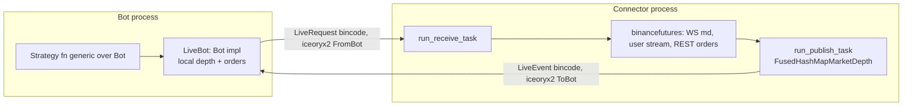

# 01 — hftbacktest Architecture Analysis (Part 2 of 2)

> Same commit, sources and confidence labels as [Part 1 §0](01-architecture-analysis.md#0-sources-and-confidence) (`5f3ec40b`, MIT).
> This part covers: §7 Queue models, §8 Latency and fee models, §9 Asset types and state, §10 Multi-asset, recording, live, §11 Performance and limitations, §12 Copy / change / avoid.

---

## 7. Queue position models

### 7.1 L2 (Market-By-Price) interface

`QueueModel<MD>` (`backtest/models/queue.rs:25-40`):
- `new_order(order, depth)`: initialize when the exchange accepts a resting order.
- `trade(order, qty, depth)`: a trade printed at the order's price.
- `depth(order, prev_qty, new_qty, depth)`: the level quantity at the order's price changed.
- `is_filled(order, depth) -> f64`: the executable qty. A value > 0 means filled. NoPartial treats any positive value as a full fill.

The per-order model state is stored in `Order.q: Box<dyn AnyClone + Send>` and recovered with `downcast_mut` (`types.rs:472-486, 514`).

**Fill rule (both models):**
- `front_q_qty` is the estimated quantity ahead of you.
- When it becomes negative, `exec = round(-front/lot)` lots are executable, and `front` resets to 0 (`queue.rs:86-95, 207-216`).
- So **only the trade quantity in excess of the queue ahead** fills you.

### 7.2 Models

| Model | Code | Initial `front` | On trade at price | On level qty change | Assumption |
|---|---|---|---|---|---|
| `RiskAdverseQueueModel` | `queue.rs:44-96` | level qty at accept | `front -= qty` | `front = min(front, new_qty)` | Every cancel is behind you; you advance only via trades (or when the level shrinks below `front`). Most conservative. |
| `ProbQueueModel
` | `queue.rs:139-217` | level qty at accept | `front -= qty`; `cum_trade_qty += qty` | see the formula below | A decrease is split between ahead/behind by a probability `P(front, back)`. Trade-caused decreases are not double counted. |

**`ProbQueueModel::depth` formula** (`queue.rs:181-205`):
- `chg = prev_qty - new_qty - cum_trade_qty`, then `cum_trade_qty` is reset to 0.
- If `chg < 0` (net increase): `front = min(front, new_qty)`. Additions join behind you.
- Otherwise, with `back = prev_qty - front` and `p = prob(front, back)` (∞ → 1):
  - `front' = front − (1−p)·chg + min(back − p·chg, 0)`, then `front = min(front', new_qty)`.
- `p` is the probability that the cancellation happened **behind** you.

**Probability functions:**

| Function | Code | `p(front, back)` |
|---|---|---|
| `PowerProbQueueFunc(n)` | 221-240 | `back^n / (back^n + front^n)` |
| `PowerProbQueueFunc2(n)` | 288-307 | `back^n / (back+front)^n` |
| `PowerProbQueueFunc3(n)` | 311-330 | `1 − (front/(front+back))^n`. Used in the Rust example with n=3 (`examples/gridtrading_backtest.rs`). |
| `LogProbQueueFunc` | 245-262 | `ln(1+back) / (ln(1+back)+ln(1+front))` |
| `LogProbQueueFunc2` | 267-284 | `ln(1+back) / ln(1+back+front)`. The Python default (`py-hftbacktest/src/lib.rs:142`). |

**References and data requirements.** The models cite Rigtorp's 2013 article and the quant.SE thread (`queue.rs:130-138`). They need:
- L2 per-price updates at full depth (at least at your price)
- trades with price, qty and aggressor side
- consistent ordering between trades and depth decrements

The "cum_trade_qty" de-duplication assumes the trade is seen **before** the depth decrement it caused. On Binance the `@trade` and `@depth@0ms` streams are separate, so this ordering holds only by timestamp and is not guaranteed (INFERRED; check it on your captures).

### 7.3 L3 model

`L3QueueModel<MD>` trait (`queue.rs:382-471`) and `L3FIFOQueueModel` (`queue.rs:480-1128`):
- Exact FIFO per price with your orders interleaved; a backtest order joins at the tail.
- **Fill rule:** when a feed order gets a FILL event, every own order *ahead* of it at that price is filled, as are own orders at strictly better prices.
- **Feed modify:** requeues at the tail if the price changes or qty increases; in place otherwise (`queue.rs:877-972`). This is the mirror of the own-order modify rule.
- Requires an MBO feed with order ids (add, cancel, modify, fill). The doc comment warns that pro-rata or exotic matching breaks it.
- Not applicable to Binance public data, which is L2 only. **For your Binance use case the L3 path is only useful as a design reference for your own L3 structure.** Your queue modeling on Binance will be L2 estimation.

### 7.4 What is *not* modeled

- Queue position on modify-down is not reduced proportionally; it is kept as is.
- Hidden or iceberg orders are not modeled.
- No latency between trade print and book update.
- No modeling of your own order's effect on the level quantity the model sees.
  - INFERRED: the replayed book doesn't contain your order, so `back = prev_qty − front` ignores your own size.

---

## 8. Latency and fee models

### 8.1 Latency

`LatencyModel` trait (`models/latency.rs:14-20`): `entry(ts, &Order) -> i64` and `response(ts, &Order) -> i64`.
- **A negative return value means a rejection.** Its magnitude is the time until the local side learns of the reject (lines 22-26 and `order.rs:139-156`).

| Model | Code | Behavior |
|---|---|---|
| `ConstantLatency{entry, response}` | 28-55 | fixed values |
| `IntpOrderLatency` | 98-274 | Reads `OrderLatencyRow{req_ts, exch_ts, resp_ts}` files. **entry:** linear interpolation of `exch_ts−req_ts` over `req_ts` (lines 171-234). **response:** interpolation of `resp_ts−exch_ts` over `exch_ts` (236-273). Rows with `exch_ts <= 0` (venue rejected or overloaded) yield negative, i.e. rejected, entries. Clamps to the first or last row outside the data range. Forward-only cursors (`entry_rn`, `resp_rn`), so the query timestamps must be monotonic. |
| `OrderLatencyAdjustment` (private) | 276-295 | Offset preprocessor: adds `offset` to `exch_ts` and `2·offset` to `resp_ts`. |

Configuration:
- Builder `.latency_model(LM)` per asset (`backtest/mod.rs:197-202`).
- Python: `constant_latency(entry, resp)` / `intp_order_latency(data, latency_offset)` (`py-hftbacktest/src/lib.rs:235-310`).
- Order latency can be derived from feed latency with `generate_order_latency`.

There is a single model for all request types. The ROADMAP lists "separate latencies for place/modify/cancel/response/fill/position" as open.
- Fill notifications reuse `response()`, so there is no separate user-data-stream latency. On Binance, fills arrive over the WS user stream, while acks for REST orders arrive in the REST response. These latencies differ in practice (UNVERIFIED; measure on your system).

**Feed latency** is not a model; it is `local_ts − exch_ts` from the data plus an optional `latency_offset` (`mod.rs:186-194`, `reader.rs` `FeedLatencyAdjustment`).

### 8.2 Fees

`FeeModel::amount(&Order, amount) -> f64` (`models/fee.rs:47-50`). A negative fee is a rebate.

| Model | Code | Fee |
|---|---|---|
| `TradingValueFeeModel<CommonFees>` | 55-74 | `maker_or_taker_rate × notional` |
| `TradingValueFeeModel<DirectionalFees>` | 76-88 | plus a buyer/seller rate (e.g. stamp duty) |
| `TradingQtyFeeModel<…>` | 93-131 | rate × exec_qty |
| `FlatPerTradeFeeModel<CommonFees>` | 135-153 | flat per fill |

Maker vs taker comes from `order.maker`, which the exchange sets. There are no tiered or VIP schedules, no BNB discount, and no funding. **Funding payments for perpetuals are not modeled anywhere in the backtest** (INFERRED from searching for "funding": there are no hits in `hftbacktest/src/backtest`).

---

## 9. Asset/contract types, tick/lot, state

- `AssetType` (`backtest/assettype.rs:1-8`): `amount(px, qty)` and `equity(px, balance, position, fee)`.
  - `LinearAsset{contract_size}`: `amount = cs·px·qty`, `equity = balance + cs·position·px − fee` (lines 12-31). **Binance USDS-M and Spot are linear** with `contract_size = 1`.
  - `InverseAsset{contract_size}`: `amount = cs·qty/px`, `equity = −balance − cs·position/px − fee` (lines 35-53). Use this for COIN-M.
- **Tick/lot handling:**
  - Prices are converted to integer ticks at the boundary: `(price / tick_size).round()` in `submit_order` (`proc/local.rs:160`) and in every depth update.
  - Quantities remain `f64`; zero tests use `(qty/lot).round()`.
  - There are no min-qty, step or notional checks on submission. INFERRED: an order with qty below the lot size is accepted.
- **`State`** (`state.rs:7-62`) holds `StateValues{position, balance, fee, num_trades, trading_volume, trading_value}` (`types.rs:735-749`).
  - `apply_fill`: `position += exec_qty·side`, `balance −= amount·side`, `fee += fee_model.amount(...)`, and the counters (lines 38-46).
  - **The values are cumulative and there is no realized/unrealized split, no average entry price, no margin or leverage, no liquidation, no funding.**
  - Equity is computed from the mid at record time by the stats code.

---

## 10. Multi-asset, recording and statistics, live connector

### 10.1 Multi-asset

- `Backtest::builder().add_asset(asset)…` (`mod.rs:567-598`).
- Each asset has independent processors, books, buses, models and data files. The `EventSet` interleaves them by timestamp (§3.2).
- Asset types can differ per asset (e.g. linear and inverse together), but **`MD` must be the same type for all assets** because it is a type parameter of `Backtest<MD>`.
- **There is no shared account or margin across assets;** each asset has its own `State`.
- The scheduler cost is a linear scan of 4N slots per event. The `gridtrading_256assets.ipynb` example and the `tickers_256.json` file suggest that N≈256 is used in practice, i.e. a 1024-slot scan per event (INFERRED cost).

### 10.2 Recording and statistics

- `BacktestRecorder` (`backtest/recorder.rs`) stores a `Record{timestamp, price=mid, position, balance, fee, num_trades, trading_volume, trading_value}` each time the strategy calls `record()`. Records go into a growing `Vec<Vec<Record>>`, saved with `to_csv` or `to_npz`.
  - **Sampling is strategy-driven** (e.g. every 1 s in `algo.rs`). Fills and order events themselves are not logged.
- Python `stats/` (sub-agent survey):
  - equity = `balance + position·price·cs − fee`
  - metrics: return, annualized return, Sharpe (default 252 days), Sortino, max drawdown, return/MDD, trades, volume, value, position value and leverage
  - daily, hourly and monthly splits
- Live `LoggingRecorder` only emits `tracing::info!`.

### 10.3 Live trading reuse

- **Same code path:** strategies are written as `fn algo<MD, I: Bot<MD>>(hbt: &mut I, …)` (`examples/algo.rs`), and `LiveBot` implements `Bot` (`live/bot.rs:413-656`). Time is the wall clock; `elapse_bt` is a no-op.
- **Transport:** iceoryx2 zero-copy shared-memory pub/sub with fixed 512-byte bincode payloads (`live/ipc/iceoryx.rs`, `config.rs`). `LiveEvent`/`LiveRequest` are defined at `types.rs:128-145, 718-727`.
- **Batch semantics:** `BatchStart`/`BatchEnd` wrap a multi-level depth diff, so the bot applies it atomically before returning control.
- **Parity gaps (verified or flagged):**
  - `LiveBot::modify` is `todo!()` (`bot.rs:546-556`).
  - Only position is valid in live `StateValues`.
  - LiveBot ignores `DEPTH_CLEAR`/snapshot events (sub-agent report).
  - The Binance depth `pu` gap check is commented out (`connector/src/binancefutures/market_data_stream.rs:66-71`, "fixme: currently supports natural refresh only", line 99).
  - Orders go over REST only, not the WS API.
  - A hard-coded 60 s wait timeout.
- **Design lesson for you:** parity is achieved at the *API* level (a trait), not at the *event* level. The backtest and live engines are different code, so backtest/live discrepancies arise from engine differences, not just model error.

---

## 11. Performance techniques actually used, and known limitations

### 11.1 Techniques (verified in code)

| Technique | Where |
|---|---|
| 64-byte, cache-line-sized and aligned POD event; array-of-structs | `types.rs:312`; `data/mod.rs` |
| Load to a 64-byte-aligned buffer and reinterpret in place (zero-copy after read); header alignment enforced | `data/npy/mod.rs:285-290`; `utils/aligned.rs` |
| Background file loading plus a prefetch of the next day | `reader.rs` `load_data` / `next_data` |
| Flat, aligned timestamp array scheduler; branch-light min scan; `transmute` decode | `evs.rs` |
| `get_unchecked` / `get_unchecked_mut` to drop bounds checks | `mod.rs:777,800,822,845`; `roivectormarketdepth.rs` |
| Const generics to specialize hot paths (`WAIT_NEXT_FEED`, `MAKE_RESPONSE`, `DELETE`, `USE_HANDLER`) | `mod.rs:755`; `proc/*` `fill::<…>`; `queue.rs:448` |
| Static generics inside processors, one `dyn` hop per event | `mod.rs:82-86, 254`; `proc/*` |
| Combinatorial monomorphization macro (2 asset × 2 latency × 7 queue × 2 exchange × 3 fee) for Python | `py-hftbacktest/src/lib.rs:514-566`; `hftbacktest-derive` `build_asset` |
| `Rc<UnsafeCell<VecDeque>>` order bus (no RefCell borrow checks) | `order.rs:8-10` |
| Choosing between iterating the price ladder and the whole order map, by size | `nopartialfillexchange.rs:253-271` |
| Release profile: LTO, 1 codegen unit, `panic=abort` | workspace `Cargo.toml` |

### 11.2 Hot-path allocation and other performance weaknesses (from code; not measured)

- **Every `Order` owns a `Box<dyn AnyClone>`.** Each `order.clone()` heap-allocates, and clones happen on submit, on every response (`respond(order.clone())`), in `Order::update` (`q.clone()`), and when inserting into the exchange map.
- **`order_ids.clone()` of a `HashSet`** inside the fill loops (`nopartialfillexchange.rs:265, 301, 569, 595`) allocates per trade or crossing event when you have resting orders at the touched ticks.
- The L3 queue model returns a `Vec<Order>` per event (`queue.rs:504, 994`); it uses `VecDeque::remove` with linear scans and never shrinks its maps.
- HashMap-based depth means a hash lookup per tick in best-price recovery, plus allocation on level insert.
- Whole-file loads (no mmap). The `.npz` decompression cost is paid per file; memory holds ≥ 1 full day per processor pair.
- The `Rc`, `RefCell` and `UnsafeCell` design makes the engine single-threaded. Parallelism is "many backtests in parallel" only, e.g. the Python grid search.
- No published throughput benchmark in the repo (UNVERIFIED performance numbers). Phase 2 will measure events/s on sample data.

### 11.3 Correctness and modeling limitations (verified unless labeled)

| # | Limitation | Evidence |
|---|---|---|
| 1 | Partial fills (maker partials, multi-leg taker sweeps, partial IOC) are not applied to local position/balance | `proc/local.rs:102-104`; `partialfillexchange.rs:230-239`; issue #316 (open) |
| 2 | Non-deterministic response order for simultaneous fills (HashMap iteration) | `nopartialfillexchange.rs:256, 292`; PR #325 (open) |
| 3 | No market impact: takers don't consume liquidity; own orders are absent from the replayed book | doc comments `nopartialfillexchange.rs:58-62`, `partialfillexchange.rs:67-70, 466-469`; `docs/order_fill.rst` |
| 4 | Trade-through fills the whole order regardless of trade size | `check_if_*_filled` `Ordering::Less/Greater` branches |
| 5 | FIFO-only order bus; a single latency model for all request types; fills share the response latency | `order.rs:34-47`; `latency.rs:14-20`; ROADMAP |
| 6 | Snapshot rows don't clear by themselves (a preceding clear is required); converters don't splice by `U/u/pu`; the live connector has no gap check | `proc/local.rs:296-299`; `binancefutures.py`; `market_data_stream.rs:66-71`; issue #300 |
| 7 | L3 + partial-fill not implemented; L3 fill events without a side are ignored; clear events expire all own orders | `mod.rs:546`; `l3_nopartialfillexchange.rs:341-358, 394` |
| 8 | Market orders in PartialFill walk only ±100 ticks | `partialfillexchange.rs:503-516, 633-647` |
| 9 | Market order on an empty side fills at a sentinel tick (no guard) | INFERRED from `ack_new` `OrdType::Market` branches |
| 10 | ROI depth drops out-of-window updates silently; `snapshot()` unimplemented for ROI/BTree | `roivectormarketdepth.rs:150-160, 503`; `btreemarketdepth.rs:244` |
| 11 | No funding, margin, liquidation, lot/notional validation | absence in `state.rs`, `assettype.rs`, `proc/local.rs::submit_order` |
| 12 | Live: `modify` is `todo!()`; partial `StateValues`; REST-only orders | `live/bot.rs:546-556, 436-440`; ROADMAP |
| 13 | Python data tools: Tardis snapshot truncation (#339); `create_last_snapshot` leak (#334); ROI `best_*_qty` binding bug (#333) | issues (open), from the sub-agent report |

---

## 12. Design decisions: copy, change, avoid (tailored to Binance MM)

| Decision in hftbacktest | Verdict | Reasoning for your C++ Binance market-making system |
|---|---|---|
| Single event stream with EXCH/LOCAL flags; each side replays at its own timestamp | **Copy** | Encodes feed latency as data, prevents lookahead by construction, and enables two books. Fits your own live captures, which have precise local timestamps. |
| 64-byte POD event, AoS | **Copy, with changes** | Keep 64 B and `static_assert`. Store **price as int64 ticks** and **qty as int64 lots** (BTC/ETH tick 0.01) instead of f64; this removes rounding at every hop and makes output byte-reproducible. Add `seq`/`update_id` fields for Binance `U/u/pu`. |
| Separate local and exchange processors with two books and two states | **Copy** | Core realism mechanism. The local state is what the strategy sees, and that view is what your live system sees too. |
| Order bus with modeled entry/response latency, negative latency = reject | **Copy concept, change details** | Use fixed-capacity ring buffers (no `VecDeque` growth). Use **separate latency channels** for REST ack, WS user-stream fill and cancel, matching how Binance delivers them. Keep a reject channel. Optionally allow non-FIFO REST arrival behind a flag. |
| `EventSet`: linear min-scan over 4N slots, fixed tie-break | **Copy for N ≤ 16; change for larger N** | Branch-light and cache-friendly for BTC+ETH (8 slots). Document the tie-break explicitly. A 4-ary heap or tournament tree is only worth it for many assets. |
| Pull API (`elapse`, `wait_next_feed`) owned by the strategy | **Change** | You want an event-driven `on_depth/on_trade/on_order` interface identical to your live engine. Provide a driver that calls callbacks, plus an optional pull adapter for parity with hftbacktest during differential tests. |
| Trait-level live parity (a separate LiveBot engine) | **Change** | Make the *strategy-facing event types and order-gateway interface* identical; the backtest exchange simulator and the live Binance gateway both implement the same gateway concept. Avoids `modify` = `todo!()`-style gaps. |
| `Box<dyn AnyClone>` per order for queue state | **Avoid** | Heap allocation per clone, plus RTTI downcasts. Use a POD per-order queue state (`qty_ahead`, `cum_trade`) inside the pool node, with the model chosen as a template policy. |
| HashMap depth + per-tick hash walk | **Change** | Use a dense tick-indexed window around the mid with recentering, and an overflow map for far levels (never drop updates silently like ROI does). Optionally a non-empty-level bitmap. |
| L3 via separate `VecDeque<Order>` per price in the queue model | **Avoid → use your design** | Your intrusive list per `PriceLevel` with 32-bit pool indices gives O(1) cancel and a unified book and queue. Use the same node type for own orders under L2 (aggregate qty + own nodes with `qty_ahead`). |
| `ProbQueueModel` family with pluggable probability | **Copy (as policies)** | Well understood and cheap. Make it a template policy so it inlines. Validate it against your live fills (Phase 3 "trustworthiness"). |
| Trade-through ⇒ full fill; crossing ⇒ maker fill at own price | **Copy as default, make configurable** | Reasonable for small MM size on BTC/ETH. Add an option to cap the fill to the trade qty, to bound optimism. |
| No self-impact | **Keep for v1, flag it** | Fine for small quotes. Add diagnostics: the fraction of fills where your size exceeds X% of level qty. |
| Partial-fill accounting only on `Filled` | **Avoid (bug)** | Apply every execution report (each with its own `last_qty`/`last_px`), like Binance `ORDER_TRADE_UPDATE`. One fill = one immutable record. |
| `HashMap` iteration order in fill loops | **Avoid** | Use deterministic containers (index-ordered pools, sorted per-level lists). Required for byte-identical output. |
| Whole-file load of `.npz` (zip+deflate) | **Change** | Use an uncompressed, page-aligned custom binary format with `mmap` + `madvise(SEQUENTIAL)`. Compress at rest with zstd and decompress once into a cache directory. |
| Background thread per file load | **Change** | A single prefetch thread or `madvise(WILLNEED)`, deterministic regardless of timing, since data is independent of thread scheduling. |
| Separate connector process via shared memory | **Optional / later** | Your live system already exists in C++. Reuse its gateway in-process; IPC is out of scope for the backtester. |
| Data pipeline without `U/u/pu` sequencing | **Avoid** | Implement Binance's documented diff-depth sync (buffer, snapshot, align on `lastUpdateId`, check `pu`) and emit explicit gap/resync events so the simulator can invalidate queue estimates. |
| Cumulative `StateValues`, no funding/margin | **Change** | Add realized/unrealized PnL, average entry, funding events (Binance 8 h funding from `markPrice` stream data), fee tiers. Record per-fill and per-order logs, not just sampled snapshots. |
| Strategy-chosen u64 order ids, unique across sides | **Copy** | Matches Binance `newClientOrderId`. Map to an internal 32-bit pool index. |

---

**End of Phase 1.** See the chat summary for open questions.
